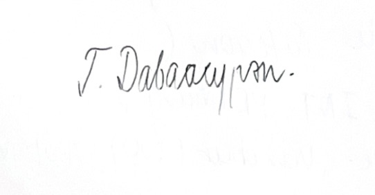
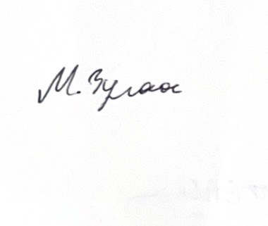
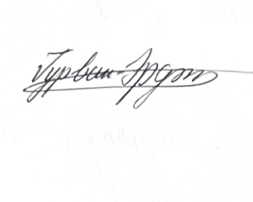

# БАГИЙН ГЭРЭЭ (БД-3)

**Хичээл:** Мэргэжлийн удиртгал (ШУТИС-МХТС, Программ хангамжийн инженерчлэл).  
**Багийн нэр ба дугаар:** 14-р баг.
**Сонгосон сэдэв:** №14 — *Hallucination: хэлний загвар яагаад итгэлтэйгээр худал ярьдаг вэ*

---

## 1. Гишүүд (нэр, оюутны код)
1. Б.Сарангэрэл (`sarkaenn089`) — Б.Сарангэрэл В252270168
2. Г.Даваасүрэн (`gurvanerdene777-png`) — Б.Гурван-Эрдэнэ В252270161
3. М.Зулаа (`ZulaaMunkhtooj236`) — М.Зулаа B252270166
4. Б.Гурван-Эрдэнэ (`thomasWilliam515`) — Г.Даваасүрэн B252270197 

---

## 2. Үүрэг хуваарилалт
*(Удирдамжийн 5 үүрэг хуваарилалтад тулгуурлан хуваарилсан)*

* **Зохицуулагч:** Б.Сарангэрэл — Цаг товлох, ажлын хуваарь гаргах, гишүүдийн ажлыг нэгтгэх, багшид тайлагнах, ажлын бүртгэл (лог) хөтлөх.
* **Судалгаа:** Г.Даваасүрэн — Эх сурвалж хайх, найдвартай байдлыг нь шалгах, товч тэмдэглэл гаргах, иш татлагийн жагсаалт бэлтгэх.
* **Анализ:** М.Зулаа — Цуглуулсан материалыг ангилах, харьцуулах, дүгнэлт боловсруулах, эсрэг байр суурийг тусгах.
* **Бичиг баримт:** Б.Сарангэрэл — Тайлангийн бүтэц, хэл найруулга, эх сурвалжийн зөв тэмдэглэгээ, AI хэрэглээний тэмдэглэлийг хариуцна.
* **Илтгэл:** Б.Гурван-Эрдэнэ — Слайд бэлтгэх, цаг тааруулах, багийг илтгэлд бэлтгэх, асуултад хариулт бэлтгэх.

> *Санамж:* Үүрэг хуваарилалт нь зөвхөн тухайн хэсгийг мэдэх гэсэн үг биш бөгөөд хамгаалалт/асуулт хариултын үеэр багийн аль ч гишүүн ажлын аль ч хэсэгт хариулах бэлтгэлтэй байна.

---

## 3. Тогтмол уулзалтын цаг ба харилцаа
* **Тогтмол уулзалтын цаг:** Долоо хоногт **2 удаа** (Мягмар, Пүрэв, 10:00 болон 16:00, МХТС-ийн номын сан).
* **Харилцах суваг:** GitHub, Messenger.
* **Ажлаа хуваалцах хэрэгсэл:** GitHub репозитори.

---

## 4. Дотоод эцсийн хугацаа
* **Тойм (эх сурвалжийн жагсаалт 10+ ба тойм):** 2026 оны 11-р сарын 20.
* **Түүхий өгөгдөл (туршилтын 10+ жишээ, тэмдэглэл):** 2026 оны 11-р сарын 20.
* **Тайлангийн төсөл:** 2026 оны 11-р сарын 20.
* **Эцсийн хувилбар (тайлан, слайд, 5–7 мин видео илтгэл):** 14 дэх долоо хоногийн эцэс хүртэл.

---

## 5. Гишүүн үүргээ биелүүлээгүй бол
* **Багийн дотоод зохицуулалт:** Эхлээд дотоод уулзалтаар шалтгааныг ярилцаж, үүрэг/хугацааг нөхөн зохицуулна. Гурваас доошгүй эх сурвалжаар (үе тэнгийн үнэлгээ, ажлын бүртгэл, багшийн ажиглалт) оролцоогүй нь нотлогдвол холбогдох дүрмийн дагуу тооцно.
* **Багшид мэдэгдэх хугацаа:** 14 дэх долоо хоног дуустал (зөрчил, асуудал гарсан даруйд эрт мэдэгдэнэ).

---

## 6. Гарын үсэг ба огноо

| № | Багийн гишүүний нэр | Гарын үсэг |
| :--- | :--- | :---: |
| 1 | Б.Сарангэрэл |  |
| 2 | Г.Даваасүрэн |  |
| 3 | М.Зулаа |  |
| 4 | Б.Гурван-Эрдэнэ |  |

**Огноо:** 2026.11.11
